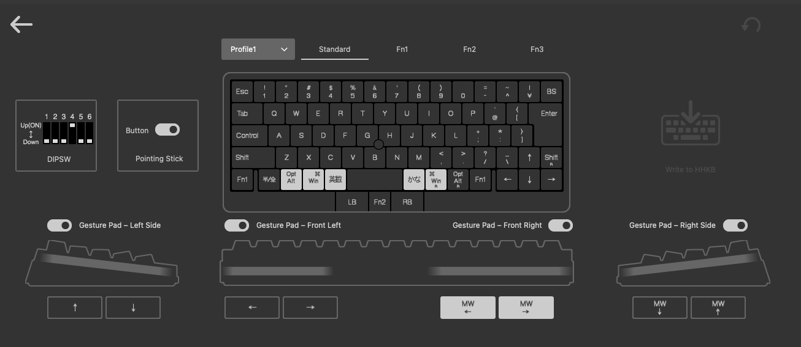
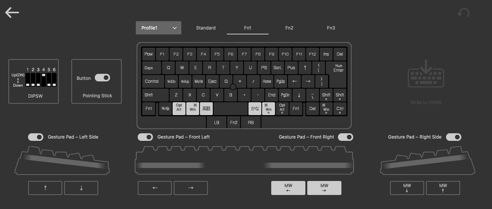
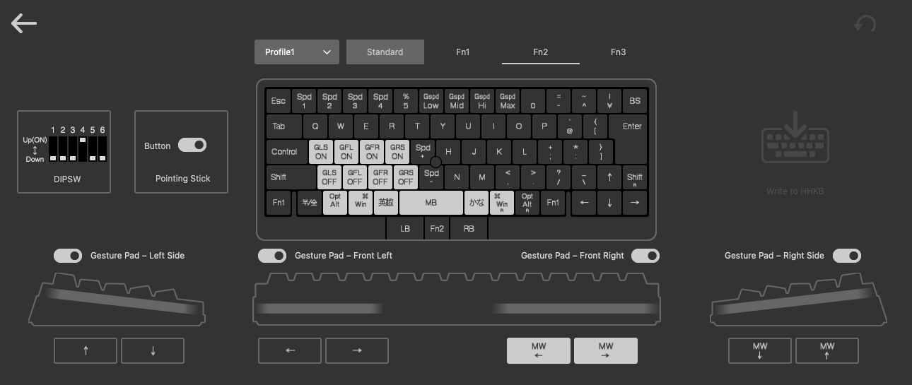
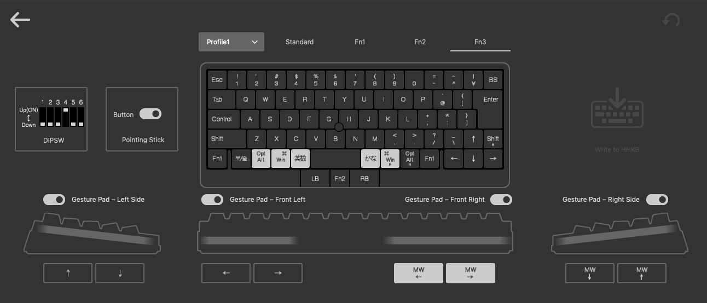

# 07 — HHKB Studio (JIS): keymap and settings

The owner's HHKB Studio JIS, as set in PFU's keymap tool for the Studio (**Profile1**). Use this
as the reference when setting up a Studio. `01-hardware.md` covers the parts both models share
(the bottom-row codes and the DIP-before-keymap order). This file covers what's specific to the
Studio.

Checked on the owner's board: with these settings, the Standard bottom row emits
`grave_accent_and_tilde`, `left_option`, `left_command`, `japanese_eisuu`, `spacebar`,
`japanese_kana`, `right_command`, `right_option`, then the arrows. Fn1+P emits `pause` (macOS sees
F15), and Fn1+I emits `print_screen` (macOS sees F13).

## Settings outside the keymap

| Setting | Value |
| --- | --- |
| DIP switches | **SW4 ON** (reverse scroll direction), SW1–3, 5, 6 OFF |
| Pointing stick → Button | **On** (LB / Fn2 / RB keys below the space bar) |
| Gesture Pad – Left Side | On: ↑ / ↓ (arrow keys) |
| Gesture Pad – Front Left | On: ← / → (arrow keys) |
| Gesture Pad – Front Right | On: **MW←** / **MW→** (horizontal mouse wheel) |
| Gesture Pad – Right Side | On: MW↓ / MW↑ (vertical mouse wheel) |

As with the HYBRID Type-S, **set the DIP switches before writing the keymap** (`01-hardware.md`).

Karabiner's only Studio-specific config is the `is_keyboard` device entry for vendor `1278` /
product `21` (`03-karabiner.md`). Leave the Studio's pointing-device and consumer entries alone.
The gesture pads and pointing stick keep working through Karabiner without any rules.

## Standard layer



Stock JIS layout except for the bottom row:

```
Fn1 | 半/全 | Opt | ⌘ | 英数 | Space | かな | ⌘ | Opt | Fn1 | ← | ↓ | →
              LB | Fn2 | RB          (pointing-stick buttons, below Space)
```

- **半/全** is the Studio's "HHKB key" (the Studio has no HHKB-logo key on the bottom row). It
  emits `grave_accent_and_tilde`, which Karabiner turns into F18 → Korean 2-Set.
- **Opt / ⌘ / 英数** on the left and **かな / ⌘ / Opt** on the right match the HYBRID Type-S
  layout.
- The key left of A is **Control**. ↑ sits in the Shift row, left of the right Shift.

## Fn1 layer



Hold either **Fn1** key (bottom row, outer ends). Keys not listed pass through as Standard.

| Key | Fn1 + key |
| --- | --- |
| Esc | Power |
| 1 … 0, -, ^ | F1 … F12 |
| ¥ / BS | Insert / Delete |
| Tab | Caps Lock |
| I / O / P | **Print Screen** (→ Cmd+Shift+4 via Karabiner) / Scroll Lock / **Pause** (→ Play/Pause via Karabiner) |
| @ | ↑ |
| Enter | Numpad Enter |
| A / S / D / F | Volume Down / Volume Up / Mute / Eject |
| H / J | Numpad `*` / Numpad `/` |
| K / L | Home / Page Up |
| ; / : | ← / → |
| N / M | Numpad `+` / Numpad `-` |
| , / . | End / Page Down |
| / | ↓ |
| ↑ (Shift row) | Right Shift |
| ← / ↓ / → | Delete / Right ⌘ / Right Control |

## Fn2 layer



Hold **Fn2** (between LB and RB). Pointing-stick and gesture-pad controls:

| Key | Fn2 + key |
| --- | --- |
| 1 / 2 / 3 / 4 | Pointing-stick speed 1 / 2 / 3 / 4 |
| G / B | Pointing-stick speed + / − |
| 6 / 7 / 8 / 9 | Gesture-pad speed Low / Mid / Hi / Max |
| A / S / D / F | Gesture pad on: Left Side / Front Left / Front Right / Right Side |
| Z / X / C / V | Gesture pad off: Left Side / Front Left / Front Right / Right Side |
| Space | Middle mouse button |

The bottom row stays the same as Standard, so 半/全, 英数 and かな work while Fn2 is held.

## Fn3 layer



Unused: identical to Standard.

## Check

With Karabiner and Hammerspoon set up, run the checklist in `06-verification.md` on the Studio.
Rows 3–14 cover the bottom row, Fn1+P and Fn1+I.
