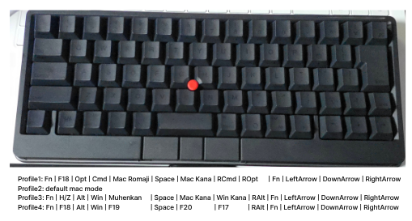
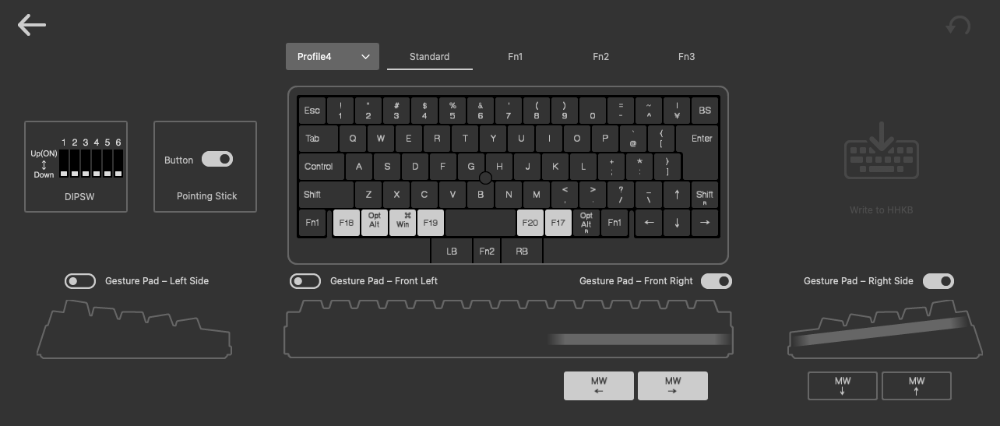
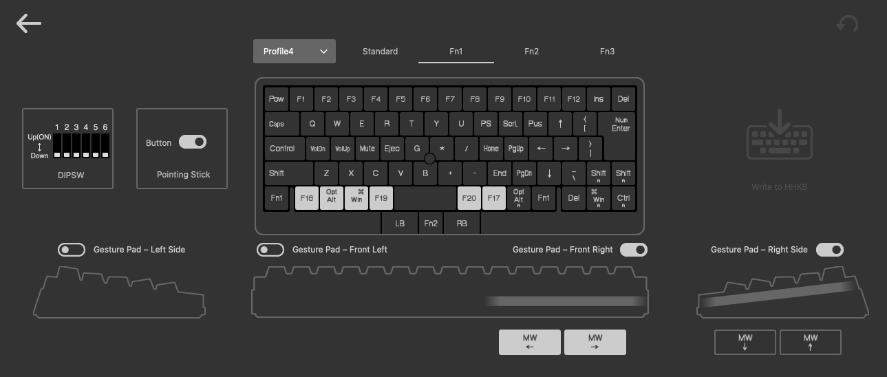
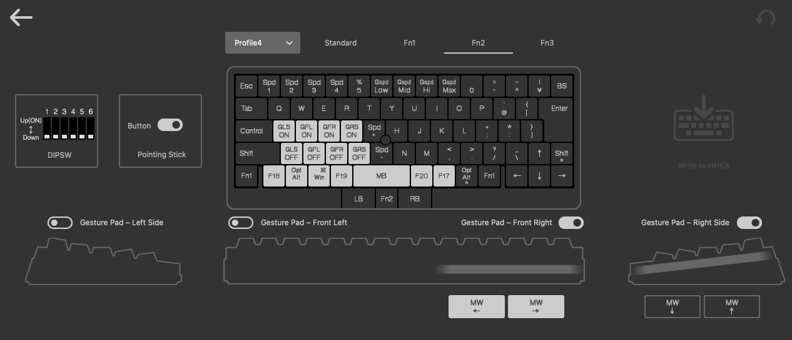
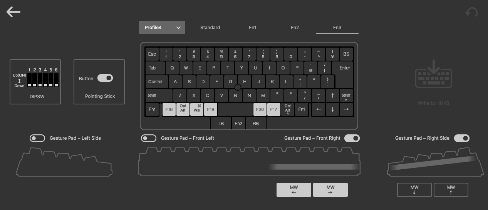
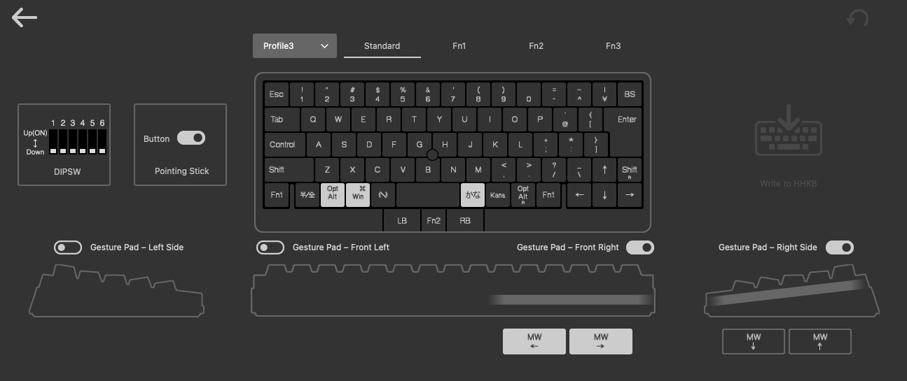
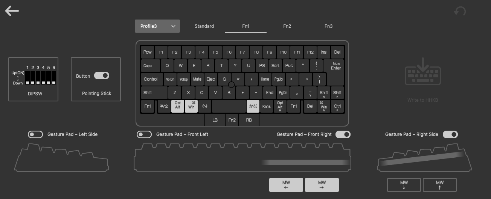
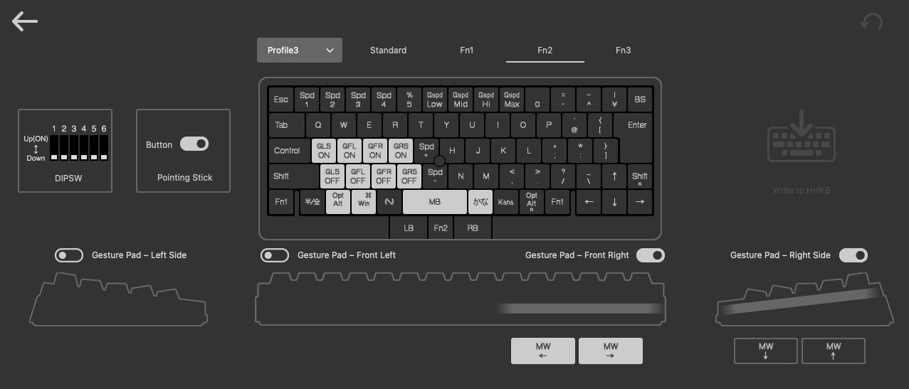
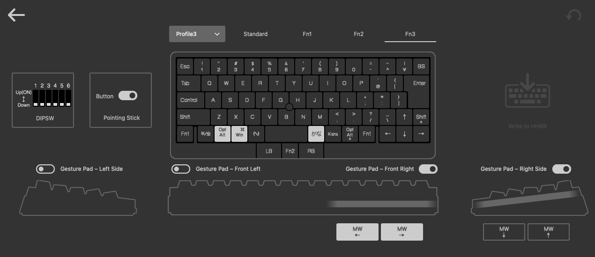

# Windows 01 — HHKB Studio JIS, keymap Profile 4

The Windows setup uses the same HHKB Studio JIS as the Mac (`docs/07-hhkb-studio.md`), but a
**different keymap profile**: the Mac keeps **Profile1** (native 英数 / かな), Windows uses
**Profile 4**. Both profiles live on the keyboard, so neither OS needs the other's keymap.
**Profile3** is a fallback for Windows PCs without AutoHotkey: Win/Alt swapped, stock 変換 key
changed to the international key `LANG1`, native Korean IME ([below](#profile3-fallback-without-autohotkey)).



| Property | Value |
| --- | --- |
| USB vendor / product | `04FE` / `0015` (PFU Limited, HHKB Studio) |
| Windows sees (USB) | USB composite device: HID keyboard (`MI_00`), mouse (`MI_02`), consumer + system control (`MI_03`), two vendor-defined interfaces |
| DIP switches | All OFF (same as the Mac) |
| Keymap profile | **Profile 4** |

## Fast path: load the default settings file

[`hhkb-studio-setting-all.hks`](hhkb-studio-setting-all.hks) is the owner's full HHKB Studio
export (Keymap Tool 1.1.2.0): DIP switches all OFF, pointing-stick button on, gesture pads
(Front Right and Right Side on), and the keymap for **every profile**, including Profile1 for macOS,
Profile 4 below, and the Profile3 fallback. In the HHKB Studio Keymap Tool, load the file and write it to the keyboard.
Importing it **replaces all profiles**, so first save your own export if you keep a custom keymap
on another profile. Then check the four layers against the screenshots below.

To set the keys by hand instead, follow the rest of this page.

## Bottom row on Profile 4

Written with the HHKB Studio Keymap Tool (on another computer is fine; the keymap is stored on the
keyboard). Set the four F keys on **every layer** (Standard, Fn1, Fn2, Fn3), as the Mac doc does
for F18, so holding Fn1 or Fn2 never changes what they send.

```
Fn1 | F18 | Alt | Win | F19 | Space | F20 | F17 | RAlt | Fn1 | ← | ↓ | →
```

| # | Position (Mac Profile1 role) | Profile 4 | Windows meaning |
| --- | --- | --- | --- |
| 1 | Fn1 | Fn1 | HHKB Fn layer |
| 2 | 半/全 (F18 / HHKB key) | **F18** | → Korean, 한 (`03-autohotkey.md`) |
| 3 | Option | Alt | Left Alt |
| 4 | Command | Win | Left Windows |
| 5 | 英数 | **F19** | → English (Japanese IME off) |
| 6 | Space | Space | |
| 7 | かな | **F20** | → Japanese hiragana, kana typing |
| 8 | Command | **F17** | Context action: 한자 in Korean, nothing elsewhere yet |
| 9 | Option | Right Alt | |
| 10 | Fn1 | Fn1 | HHKB Fn layer |
| 11–13 | ← ↓ → | ← ↓ → | |

Fn-layer keys used (stock Fn1 layer): **Fn1+P → Pause** (→ Media Play/Pause in AutoHotkey),
**Fn1+I → Print Screen** (behavior on Windows: not decided yet).

## Tested on

The owner's PC, as of 2026-10-17. The HHKB has only been tested over **USB** so far; Bluetooth is
not done yet and may behave differently.

| Item | Value |
| --- | --- |
| Model | Samsung Galaxy Book Pro (950XDC / 951XDC / 950XDX) |
| Windows | 11 Pro 25H2, build 26200.9457, 64-bit; display languages en-US + ko-KR |
| CPU | Intel Core i7-1165G7 (11th gen, Tiger Lake; 4 cores / 8 threads) |
| RAM | 16 GB LPDDR4x-4267 (soldered) |
| GPU | Intel Iris Xe + NVIDIA GeForce MX450 (plus a remote-desktop virtual display) |
| USB controllers | 2 × Intel USB 3.10 xHCI: Thunderbolt side `8086:9A13`, chipset (PCH) side `8086:A0ED` |
| Bluetooth | Intel Wireless Bluetooth (`8087:0032`, internal USB on the PCH controller) |
| Built-in keyboard | PS/2-style over ACPI (`ACPI\MSF0001`), handled by `i8042prt` |

USB tree, trimmed (`VID:PID`; peripherals other than the HHKB are generic):

```
PCH xHCI 8086:A0ED
└─ Root hub (USB 3.0)
   ├─ port 2: HHKB Studio 04FE:0015   ← plugged straight into the non-Thunderbolt USB-C port
   │    MI_00 keyboard · MI_01 vendor · MI_02 mouse (pointing stick) · MI_03 consumer + system control · MI_04 vendor
   ├─ Intel Bluetooth 8087:0032 → 2 Bluetooth LE mice
   ├─ built-in camera, fingerprint sensor, card reader
   └─ USB 2 hub chain (USB-C dock) → cooling pad (its own HID keyboard interface) · USB mouse
Thunderbolt xHCI 8086:9A13
└─ Root hub (USB 3.0) → USB 3 hub chain (same USB-C dock) → USB Ethernet adapter
```

Windows lists four keyboards on this PC: the HHKB, the built-in one, the cooling pad's HID keyboard
interface, and a converted HID keyboard. All of them get the same hardware layout (`02-windows.md`, step 3).

## Profile 4 keymap (screenshots)

As written by `hhkb-studio-setting-all.hks`. The four bottom-row F keys are the same on every
layer.

### Standard layer



### Fn1 layer



### Fn2 layer



### Fn3 layer



## Measure, don't assume

Expected virtual-key codes: F17 `0x80`, F18 `0x81`, F19 `0x82`, F20 `0x83` (scan codes `0x68`–`0x6B`).
Check them with AutoHotkey's **KeyHistory** (tray icon → Open → View → Key history) after pressing
each bottom-row key, plain and with Fn1 held.

Measured on the owner's board (2026-10-17, with a separate key-test tool): all four F keys
(F17–F20) arrive correctly from the bottom row.

## Profile3: fallback without AutoHotkey

**Win/Alt swap, and the stock 変換 (Henkan) key changed to the international key (HID `LANG1`).
Supports the native Korean IME on Windows.**

For a Windows PC where AutoHotkey isn't installed or isn't allowed: select **Profile3** on the
keyboard. It's PFU's stock Windows JIS keymap with two changes. The bottom row is the same on
every layer:

```
Fn1 | 半/全 | Alt | Win | 無変換 | Space | LANG1 (was 変換) | かな | RAlt | Fn1 | ← | ↓ | →
```

| Position | Stock Windows JIS | Profile3 | Windows meaning |
| --- | --- | --- | --- |
| Left of 無変換 | Win, Alt | **Alt, Win** (swapped) | Alt and Windows keys in the same places as Option / Command on the Mac |
| Right of Space | 変換 (`International4`) | **`LANG1`** (the keymap tool shows it as かな) | **한/영** toggle, but only while Korean is the active language (`03-autohotkey.md`, "Native 한/영") |
| everything else | | stock | 半/全, 無変換 and かな keep their stock Windows JIS codes |

Fn2 also has the gesture-pad on/off keys (GLS / GFL / GFR / GRS), as on the Mac (`07-hhkb-studio.md`).

How it behaves (**only 한/영 is tested**):

- Switch languages with Windows' own shortcut, **Win+Space**. Nothing on Profile3 selects a
  language directly, so the one-way keys of Profile 4 aren't available here.
- 한/영 works (tested by the owner): the `LANG1` key toggles 한↔영 while Korean is active. While
  Japanese is active, the same key does nothing visible.
- Japanese IME keys (半/全, 無変換, かな) are stock JIS codes. They need the JIS hardware layout
  (`02-windows.md`, step 3) to mean anything: without it they type `` ` ``, nothing, or an
  unmapped code (measured in `03-autohotkey.md`). Not tested with JIS active.

### Profile3 keymap (screenshots)

As written by `hhkb-studio-setting-all.hks`.

#### Standard layer



#### Fn1 layer



#### Fn2 layer



#### Fn3 layer


