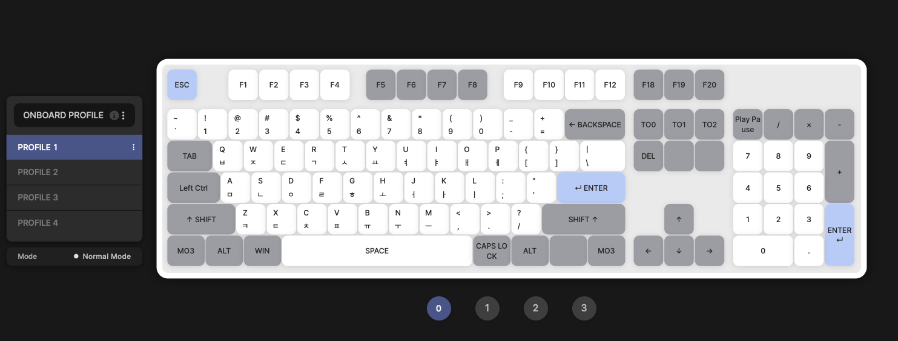
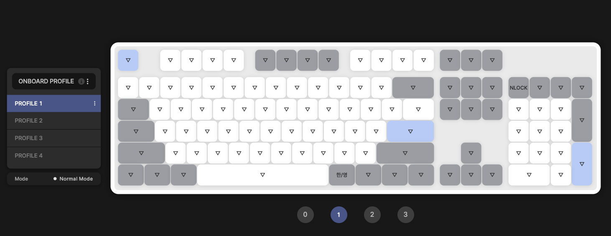
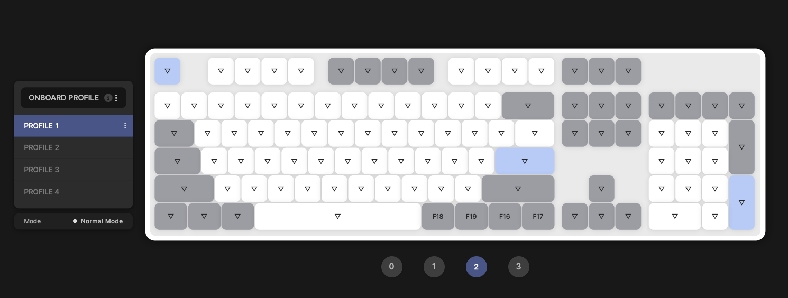
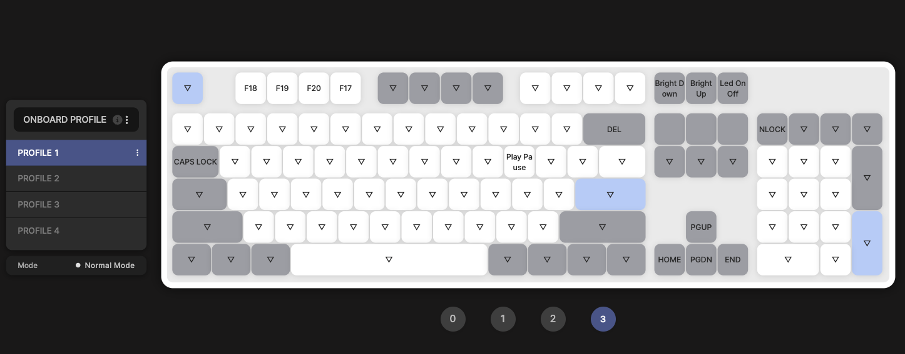

# 104 / 108-key US ANSI keyboard (not an HHKB; support limited)

> [!WARNING]
> **Not part of the default setup.** This repo is built for JIS HHKBs. Use this folder only if the
> user has a full-size **104-key** (US) or **108-key** (Korean, with 한/영 and 한자 keys) **US ANSI**
> keyboard and insists on setting it up anyway. Tell them support is limited before going on.

The owner's full-size keyboard, a **TFG Magnetox** (US ANSI), set up in its web configurator
([app.superstore.com](https://app.superstore.com/)). There are no 英数 / かな keys on ANSI, so the
language keys come from the keyboard's own firmware as **F18 / F19 / F20 / F17**, the same codes
the HHKB Studio sends on Windows (`../docs/windows/01-hardware.md`).

| File | What it is |
| --- | --- |
| [`tfg-magnetox-fullkey-config.json`](tfg-magnetox-fullkey-config.json) | The owner's export from the configurator, all four profiles. Only **Profile 1** belongs to this setup |
| [`images/`](images/) | Screenshots of Profile 1, layers 0–3 |

For any other 104 / 108-key board, set the same keys by hand in that board's own tool. The table
below is the reference.

## Profile 1

Layers 1 and 2 are base layers you lock in with **TO1** / **TO2** (back with **TO0**). Layer 3 is a
momentary layer: hold **MO3**. Keys not listed are the normal US ANSI keys.

### Layer 0 (base)

| Position | Sends |
| --- | --- |
| Print Screen / Scroll Lock / Pause | **F18 / F19 / F20** |
| Insert / Home / Page Up | **TO0 / TO1 / TO2** (lock base layer 0 / 1 / 2) |
| Delete | Delete |
| End / Page Down | Nothing |
| Caps Lock (left of A) | **Left Control** |
| Bottom row, left → right | **MO3**, Alt, Win, Space, **Caps Lock**, Alt, nothing, **MO3** |
| Num Lock | **Play/Pause** |

The configurator also lists Mute, Volume Down, Volume Up and Calculator on four positions that
aren't drawn in the screenshots.

### Layer 1 (TO1)

| Position | Sends |
| --- | --- |
| Right of Space (Caps Lock in layer 0) | **한/영** (`KC_HAEN`) |
| Num Lock (Play/Pause in layer 0) | Num Lock |

### Layer 2 (TO2)

| Position | Sends |
| --- | --- |
| The four keys right of Space | **F18, F19, F16, F17** (this replaces the right MO3) |

### Layer 3 (hold MO3)

| Position | Sends |
| --- | --- |
| F1 / F2 / F3 / F4 | **F18 / F19 / F20 / F17** |
| F18 / F19 / F20 (Print Screen row) | Backlight down / up / on-off |
| Backspace | Delete |
| Insert / Home / Page Up (TO0 / TO1 / TO2) | Nothing |
| Tab | **Caps Lock** |
| P | **Play/Pause** |
| ↑ | Page Up |
| ← / ↓ / → | Home / Page Down / End |
| Num Lock (Play/Pause in layer 0) | Num Lock |

### Other profiles in the export

They aren't part of this setup: Profile 2 has a different letter layout, Profile 3 is like Profile 1
without layers (Caps Lock on both MO3 positions), and Profile 4 is the configurator's default. Check
whether importing replaces the profiles already on the keyboard, and ask the user first if it does.

## How it plugs into the rest of the repo

The language keys send the same codes as the HHKB setups, so the existing switchers work:

| Key | macOS (`../docs/04-hammerspoon.md`) | Windows (`../docs/windows/03-autohotkey.md`) |
| --- | --- | --- |
| F18 | Korean (Hammerspoon, any keyboard): JIS Korean, see the limits below | Korean (AutoHotkey): JIS Korean, the same limits |
| F19 | **No handler by default.** Bind it to ABC (`../docs/05-customization.md`) | English (AutoHotkey) |
| F20 | **No handler by default.** Bind it to Japanese Kana (`../docs/05-customization.md`) | Japanese, kana typing (AutoHotkey) |
| F17 | Nothing | Hanja (F7) in Korean (AutoHotkey) |
| F16 | Nothing (no handler in this repo) | Nothing (no handler in this repo) |
| 한/영 (layer 1) | Not used | Native Korean IME toggle, no AutoHotkey needed (like the Studio's Profile3 fallback) |

## Limits (tell the user)

- **Korean on macOS and Windows:** F18 selects JIS Korean, which reads JIS key codes in its Mode A.
  On ANSI keycaps its number row types ㅃ ㅉ ㄸ ㄲ ㅆ / ㅟ ㅝ ㅚ ㅢ ㅘ and its symbol keys don't match
  the keys (`../issues/jis-korean-non-jis-built-in.md` has the same effect on a US MacBook). Korean
  2-Set (or the Microsoft Korean IME) would fit this keyboard, but it's no longer maintained here.
  Tell the user before going on.
- **No ろ key.** The ろ → `\` rule (`../docs/03-karabiner.md`) does nothing here. `\` is on its
  normal ANSI key.
- **macOS keyboard type:** pick **ANSI**, not JIS, when macOS asks (`../docs/02-macos.md` assumes
  JIS). The 英数 / かな steps don't apply: F19 / F20 need Hammerspoon bindings instead.
- **Karabiner device rules** are scoped to the HHKBs' USB IDs (vendor `1278`), so they don't touch
  this keyboard. Read its IDs in Karabiner-EventViewer if a rule should apply to it. The
  configurator's `vendorProductId` is `68583748` (`0x04168144`), which looks like vendor `0x0416` /
  product `0x8144`, but check in EventViewer.
- **Windows symbols:** `../docs/windows/02-windows.md` sets the Japanese hardware layout to JIS
  (`kbd106.dll`) to match JIS keycaps. On ANSI keycaps that makes English (F19) and Japanese (F20)
  type symbols that don't match the keys. Not tested on this keyboard: ask the user how they want
  it before changing the layout.
- Tested only on the owner's TFG Magnetox. Measure (Karabiner-EventViewer on macOS, AutoHotkey
  KeyHistory on Windows); don't assume another board sends the same codes.
